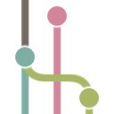

<p align="center">
  
</p>

<h1 align="center">Git Graphity</h1>

<p align="center">See your history. Find the change. Make your next move.</p>

<p align="center">
  <a href="https://marketplace.visualstudio.com/items?itemName=nulifyer.git-graphity">Install from Marketplace</a> ·
  <a href="https://github.com/Nulifyer/vscode-git-graph/releases/latest">Download VSIX</a> ·
  <a href="https://github.com/Nulifyer/vscode-git-graph/issues">Report an issue</a>
</p>

Git Graphity brings your repository history and Git workflows into one interactive view in VS Code. Explore branches, inspect changes, search every commit, and manage worktrees and rebases without leaving your editor.

## Your repository, at a glance

Follow branches, merges, tags, stashes, and uncommitted changes in a color-coded graph. Pin branch lanes, collapse linear history, and highlight ancestry to keep the changes you care about in view. Virtualized rendering keeps the visible commit list small as you browse large histories.

The view follows your active VS Code theme, including light, dark, and high-contrast themes. Keyboard navigation and accessible controls let you work beyond the mouse.

## Find the change you need

Search across the complete repository history with fuzzy matching, exact text, or regular expressions. Narrow results by author, date, or path, then jump straight to the commit. Follow a file through renames to understand how it evolved.

## From history to action

- Inspect a commit's changed files in VS Code's diff editor. Compare any two commits and keep track of reviewed files.
- Create, switch, merge, rebase, and delete branches. Fetch, pull, push, tag, and stash from the graph.
- List worktrees, create a separate workspace for another branch, and open it in VS Code.
- Plan a linear interactive rebase visually. Reorder commits, choose actions, and use VS Code's merge editor to resolve conflicts.

## Install

Search for **Git Graphity** in the Extensions view, or run:

```bash
code --install-extension nulifyer.git-graphity
```

For manual installation, download the VSIX from the [latest release](https://github.com/Nulifyer/vscode-git-graph/releases/latest). In VS Code, run **Extensions: Install from VSIX...** and select the downloaded file.

Requires VS Code **1.141.0 or newer**, Git on your PATH, and a trusted workspace with a repository on disk. Desktop and remote workspaces are supported.

## Get started

1. Open a folder containing a Git repository.
2. Run **Git Graphity: View Git Graphity (git log)** from the Command Palette, or select **Git Graphity** in the status bar.
3. Click a commit to inspect changes. Right-click a commit, branch, tag, or stash for Git actions.

Use **Ctrl/Cmd + F** inside the view to find commits. Open the toolbar's overflow menu for repository-wide search, file history, worktrees, rebase, and layout controls.

## Make it yours

Open VS Code Settings and search for `@ext:nulifyer.git-graphity`. Adjust graph colors, labels, commit ordering, default actions, and keyboard shortcuts. The default graph palette follows your theme.

Repository configuration uses `.vscode/vscode-git-graphity.json`. Settings and saved state from earlier extension identities do not transfer automatically.

## Help and development

[Report an issue](https://github.com/Nulifyer/vscode-git-graph/issues) or read the [release notes](CHANGELOG.md). For local builds, tests, and contributions, see [CONTRIBUTING.md](CONTRIBUTING.md).
